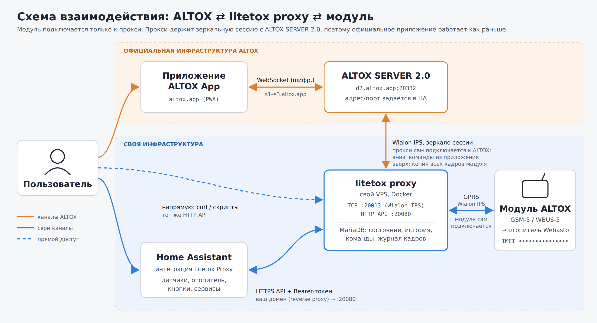

# Litetox Proxy для Home Assistant

Интеграция для модулей **ALTOX** (WBUS-5 GPS, GSM-5 и др.), подключённых к собственному прокси **litetox**: это Wialon IPS прокси с MariaDB. Модуль отправляет данные на прокси по GPRS, прокси разбирает и хранит их и зеркалит сессию модуля на **ALTOX SERVER 2.0**, так что официальное приложение ALTOX продолжает работать. Home Assistant забирает данные с прокси по HTTP API.

> [!IMPORTANT]
> Интеграция работает только вместе с прокси **[litetox](https://github.com/nightrus/litetox)**: модуль ALTOX подключается к нему, а Home Assistant забирает данные с прокси. Сначала разверните прокси (docker compose), потом добавляйте интеграцию.



<sub>Исходник схемы: [docs/scheme.html](docs/scheme.html) (SVG).</sub>

## Возможности
- Настройка через UI: адрес прокси, API-токен, IMEI трекера и название.
- При добавлении IMEI регистрируется на прокси, и прокси принимает подключения **только** от зарегистрированных IMEI. При удалении интеграции IMEI отключается.
- Одно устройство со всеми сущностями:
  - **отопитель**: выключатель START/STOP, статус работы, пламя, температура отопителя, оставшееся время, «Ошибка Webasto» (проблема; код, расшифровка `description`, совет `advice` и полный ответ модуля в атрибутах — расшифровку даёт litetox proxy 2.2+; обновляется только по кнопке «Диагностика Webasto» или команде `READ`);
  - **автомобиль**: напряжение, температура салона, скорость, пробег, движение, местоположение (`device_tracker`), выключатель «Трекинг GPS» (`TRACKING1`/`TRACKING0`; модуль не сообщает режим, показывается последняя отправленная команда — нужен litetox proxy 2.2.1+);
  - **SIM**: баланс, уровень сигнала GSM, сота, прошивка;
  - **кнопки**: «Запросить статус», «Запросить баланс», «Диагностика Webasto» (`READ`), «Стереть ошибки Webasto» (`erase`, отправляется и когда ошибок нет), «Запросить соты GSM»;
  - **выход OUT** (ACTIVATE/DEACTIVATE). По умолчанию эта сущность выключена.
- После отправки команды интеграция часто опрашивает прокси, пока модуль не ответит, поэтому состояние обновляется через несколько секунд, а не на следующем плановом опросе.
- Сервисы:
  - `litetox.start_heater` с параметром `minutes` (10–120);
  - `litetox.send_command`, который отправляет модулю любую команду из инструкции ALTOX (`STATUS`, `START:30`, `STOP`, `ussd`, `gsminfo`, `READ`, `erase`…).

## Карточка
Интеграция сама подключает Lovelace-карточку `custom:litetox-card`, ресурс добавлять не нужно. Слева нарисован автомобиль со статусами: связь, GSM, напряжение, баланс, температуры, отопитель (при работе подсвечивается). Справа запуск отопителя с выбором времени работы 10/20/30/45/60 мин (запуск подтверждается вторым нажатием, остановка срабатывает сразу), команды (на плитке диагностики есть красная кнопка «Стереть ошибки») и плитки «Спутники GPS» (со скоростью) и «Пробег» (с кнопкой включения/выключения трекинга). Под каждой командой показан её последний результат и время ответа модуля.

```yaml
type: custom:litetox-card
# все параметры необязательные
device_id: 0123abcd…        # если трекеров несколько (по умолчанию первый)
name: Freelander 2          # по умолчанию имя устройства
image: /local/my-car.webp   # вид сверху, перед машины слева (по умолчанию встроенный силуэт)
minutes: 20                 # время работы по умолчанию (иначе 30); выбранное запоминается в браузере
```

## Установка
1. Разверните [litetox proxy](https://github.com/nightrus/litetox) и пропишите его адрес в модуле.
2. HACS → Custom repositories → `https://github.com/nightrus/ha-litetox` (Integration) → установить → перезапустить HA → «Добавить интеграцию» → **Litetox Proxy**.

## Параметры
- **Интервал опроса**: по умолчанию 15 с.
- **Время работы отопителя** для выключателя: 0 означает настройку модуля (`TIME1`).
- **Адрес и порт ALTOX SERVER 2.0**: куда прокси зеркалит сессию модуля (по умолчанию `d2.altox.app` : `20332`). Пустой адрес выключает зеркало. Настройка хранится на прокси отдельно для каждого IMEI; состояние видно в диагностическом датчике «Связь с сервером ALTOX».

## Прокси
Исходники, установка и переменные окружения прокси: **https://github.com/nightrus/litetox** (Python, aiohttp, PyMySQL, MariaDB, docker compose). Кратко об API:

| Метод | Путь | Назначение |
|---|---|---|
| GET | `/health` | версия, без авторизации |
| GET/POST | `/devices` | список / регистрация IMEI (`{"imei", "name", "upstream": "host:port"}`; `""` — зеркало выключено, `null` — по умолчанию из `ALTOX_UPSTREAM`) |
| DELETE | `/devices/{imei}` | отключить IMEI |
| GET | `/state/{imei}` | текущее состояние |
| POST | `/cmd/{imei}` | `{"command": "STATUS"}` → id команды |
| GET | `/cmd/{imei}/{id}` | статус команды и ответ модуля |
| GET | `/history/{imei}?type=positions\|heater\|balance\|commands` | история |

Все запросы, кроме `/health`, требуют заголовок `Authorization: Bearer <API_TOKEN>`.

На модуле адрес прокси задаётся SMS-командой, например `IPADDR2:<ip>,IPPORT2:<port>,TRACKING1`. Слот 1 можно оставить для ALTOX.

## Лицензия

[GPL-3.0](LICENSE) © nightrus. Изменённые версии можно распространять только открыто и под той же лицензией.
